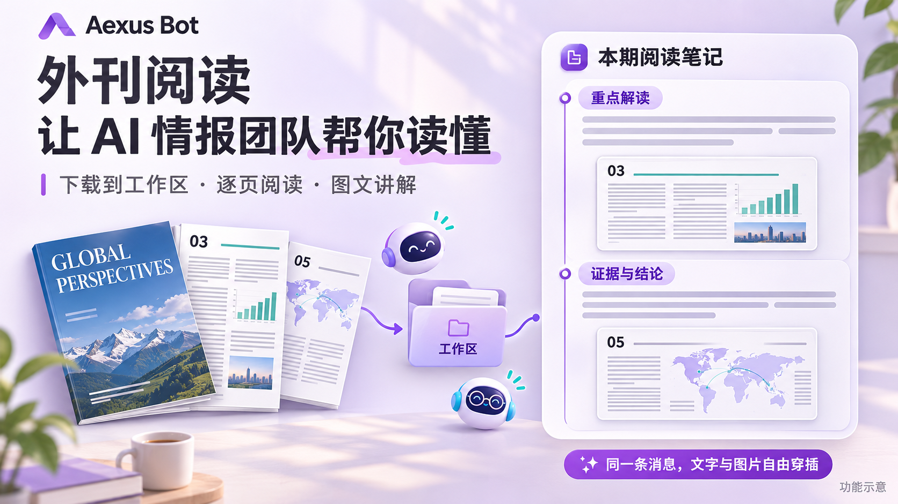

# Aexus Bot · Your Private AI Intelligence Team

[简体中文](README.md) · [English](README.en.md)

**Make access to information more equal.**

Give individuals an AI team that follows information, reads documents, develops analysis together, and keeps work moving.

Aexus Bot is a self-hosted workspace for your private AI intelligence team. Bring sources, documents, and questions into one place. Assign Agents to read, organize, discuss, and deliver findings, then use persistent tasks to follow the subjects that matter over time.

You choose the sources, responsibilities, and standards for accepting a result. Source material, conversations, files, and task records stay connected so you can revisit the evidence, compare reasoning, and ask follow-up questions.

[Get started](#getting-started) · [Deployment](docs/DEPLOYMENT.md) · [CLI / API](API.md) · [Permissions](PERMISSIONS.md)



<p align="center"><sub>Bring the PDF, original pages, and explanations back into your conversation.</sub></p>

## Why a private AI intelligence team?

Useful information is spread across platforms, documents, and discussions. Reading it consistently and turning it into useful work takes time.

Our aim is to bring information work that once required several people to an individual's desktop: helping more people discover information, understand it, and use it in their own decisions and actions. This is the information equality Aexus Bot works toward.

“Private” means you can host the system yourself, choose its models and execution engines, and control your documents, members, permissions, and workspaces. When you use cloud models or remote services, their data-processing boundaries depend on the services and configuration you select.

## Organize your information work

| What you follow | How the team can help |
| --- | --- |
| Industry, technology, or a specific topic | Connect sources, assign reading by subject, and prepare briefings with references to original material. |
| Papers, reports, and long documents | Read PDFs and documents, extract useful passages, raise questions, and produce analysis and deliverable files. |
| Different views of the same question | Ask members to examine material separately, develop views, check supporting evidence, and discuss findings in a group. |
| Subjects that need regular attention | Schedule recurring or event-triggered work and retain execution and delivery records. |
| Findings that require a decision or action | Ask the user a saved choice question, record the decision, and assign follow-up work. |

Start with a concrete request, for example:

> Prepare a daily AI industry briefing from my chosen sources. Keep the original links and identify questions worth following. Ask another member to review those judgments each week.

Specify sources, time ranges, assignees, delivery formats, and acceptance criteria. Members generate analysis according to the task; important judgments can receive an independent review and be checked against the original material.

## Let your team help you read the foreign press

Choose a magazine, report, or long document from a channel and ask a member to download it into their assigned workspace. Specify the questions, articles, or pages that matter to you, then ask the team to read, summarize, and check the evidence.

> Read the parts of this issue relevant to my questions. Explain each point, place the original page image beside it, and finish with questions worth following. Send it as one illustrated message.

Members can export a chosen PDF page as an image and alternate **text, image, text, image inside a single message**, or split the material into several messages by topic. Images retain previews, zoom, and download. Rich messages have no fixed image-count cap.

The same workflow works in private conversations, groups, and threads, with consistent APIs for local and cloud workspaces. You choose the questions and assess the findings; the team handles reading and organization. [Read the workflow and API guide](docs/MAGAZINE_READING.md).

## Three views connect information and work

### Message · Gather information and discuss it

Message brings news channels, private conversations, and groups into one workspace.

- **Information channels:** browse Telegram, X, YouTube, and other sources with source, keyword, and time filters. Members read and search through authorized interfaces.
- **Private and group conversations:** delegate directly or discuss topics with quotes, threads, polls, and collaborative checklists.
- **Material and deliveries:** share files, preview images and documents, read PDFs in Margin Reader, and retain related messages and file records.


External Workers such as Dot and Grok can also participate in conversations while keeping their native identities and histories.


<details>
<summary>See quoted replies and conversation context</summary>


</details>

### Team · Organize your intelligence members

Assign responsibilities such as source monitoring, document reading, topic analysis, independent review, and briefing preparation. A Secretary coordinates and follows up on tasks, while you inspect the members' actual work.

**Characters** presents people and team activity. **Board** lets you follow several complete employee workbenches at once. **Workers** manages independent native Agent sessions. Conversations, files, terminals, tool calls, approvals, and queues form the workbench.

Members can use different native engines and models and execute locally or in registered remote environments.

### Mission · Turn attention into sustained follow-through

Mission manages one-time, recurring, event-triggered, and persistent goals through ten layouts, including calendars, boards, and timelines.

Use Secretary supervision or independent execution, inspect runs and results, and save filters and views. Persistent goals retain reminders and follow-up until explicitly confirmed successful; a reply or native turn ending does not automatically complete the goal.

User decisions are saved as conversation choice questions. They support options, an Other free-text answer, a declared timeout decision, or indefinite waiting. New messages and other tasks do not overwrite pending questions.

## The foundation for reading, analysis, and execution

### Native Agent engines

Aexus Bot supports Codex, Claude Code, Cline, Pi, OpenCode, Kilo Code, and DeepSeek Harness. Engines use their native configuration and authentication; you choose the model providers, accounts, and associated costs.

Native Agents execute reading, analysis, file processing, and concrete work. Aexus Bot organizes members, permissions, communication, workspaces, and persistent tasks. See [engine adapters](docs/ENGINE_ADAPTERS.md) and [capabilities](ENGINE_CAPABILITIES.md) for each integration's scope.

### Documents and workspaces

Workspaces can bind directories on the Core host or registered cloud hosts. Members use their assigned workspace, while group shared content is managed separately. Files and native sessions keep stable identities across upgrades.

The repository includes three independent plugins:

- **Margin Reader:** document reading, excerpts, and reference organization.
- **MiniNotion:** notes, databases, and knowledge organization.
- **Cloud Hosts:** remote hosts, connection status, and terminals.

Grant members read, modify, or create access to specific plugin content. Information collection and server-side storage are maintained in the separate [xhs_publisher](https://github.com/Daijunfan/xhs_publisher) project; Aexus Bot provides the client and controlled integration APIs.

### Your team and permissions

Desktop, browser, CLI / API, and native member tools use the same Core and follow the same business rules and identity checks. Secretaries, Governors, Managers, and employees have distinct responsibilities; authority comes from actual roles and grants.

The current product is a single-owner, self-hosted system with support for multiple browser clients. Documents and credentials live outside application binaries. See [deployment](docs/DEPLOYMENT.md), [permissions](PERMISSIONS.md), and [security](SECURITY.md) for operational boundaries.

## Getting started

1. Start the desktop application or connect to your own Core Web backend.
2. Check native engines, model configuration, and authentication in Settings.
3. Create a team, bind its workspace, and assign responsibilities.
4. Connect sources, provide documents, or ask a specific question.
5. Discuss in Message, follow work in Team, and use Mission for ongoing attention and deliveries.

Deployment options include macOS / Windows desktop and Linux Core / Web with a browser. See [deployment](docs/DEPLOYMENT.md) for prerequisites, platform boundaries, and remote access.

### Run from source

Use Node.js **22.18+** (**22.19+** for Pi; validation baseline: Node 24), npm, and the required engines' native configuration. SSH / POSIX terminals require Python and OpenSSH.

```sh
git clone https://github.com/Daijunfan/Aexus-Bot.git
cd Aexus-Bot
npm ci
npm run setup
npm run build:plugins
npm run build
npm run dev
```

macOS packaging and installation:

```sh
python3 build.py
npm run install:mac -- --source 'release/mac-arm64/Aexus Bot.app'
```

Browser backend:

```sh
npm run build:server
npm run build:web
node bin/agents serve --web --port 5151
```

Run `node bin/agents web token` in another terminal, then sign in at `http://127.0.0.1:5151`. Use HTTPS or an SSH tunnel for another device. One Core owns each data directory.

## Documentation and development

- [Deployment](docs/DEPLOYMENT.md) · [CLI / API](API.md) · [Architecture](ARCHITECTURE.md)
- [Persistent goals and decisions](docs/MISSIONS_AND_QUESTIONS.md) · [Information channels](docs/CHANNELS.md)
- [Group collaboration](docs/GROUP_COLLABORATION.md) · [Documents and files](docs/FILES_WORKBENCH.md)
- [Engine capabilities](ENGINE_CAPABILITIES.md) · [Plugin development](PLUGIN_SPEC.md)
- [Contributing](CONTRIBUTING.md) · [Changelog](CHANGELOG.md)

Development uses `main`. The application is **Aexus Bot**, installed at `/Applications/Aexus Bot.app` on macOS.

```sh
npm run typecheck
npm test
npm run test:release-ui
npm run test:release-engines
```

Tests use temporary data and deterministic protocol fixtures. Platforms are validated separately; real-model and real-host tests are recorded explicitly. Some detailed references are written in Chinese.

## License

Project code is licensed under **GNU GPL v3**. Third-party code, artwork, native engines, and model services retain their own licenses or terms.

See [LICENSE](LICENSE), [licensing details](LICENSING.md), and [third-party notices](THIRD_PARTY_NOTICES.md).
