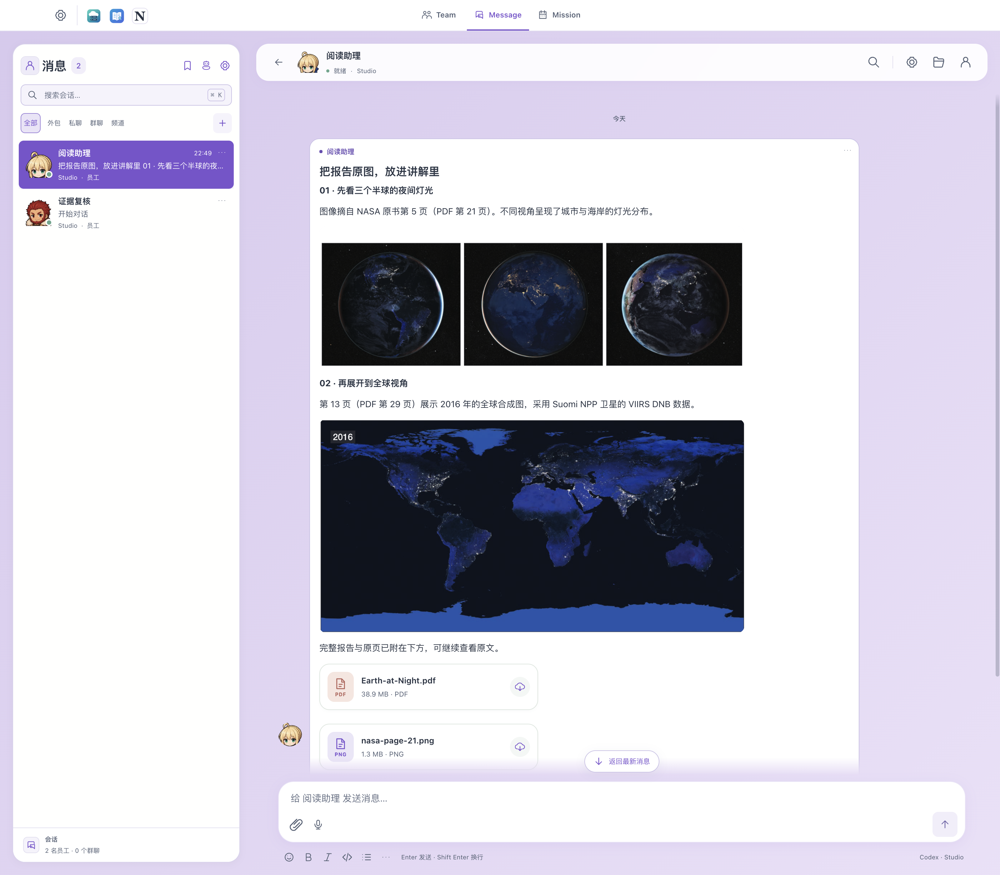

# Aexus Bot · Your Private AI Intelligence Team

[简体中文](README.md) · [English](README.en.md)

**Information access, for everyone.**

Follow the world's information. Let your AI team read, discuss, check the evidence, and keep delivering the results you care about.

Aexus Bot brings information channels, a unified document Library, multiple Agents, and persistent Missions into one workspace. Use **Library** for visual storage management, super search, Study Reader mindmaps, and Cloud Hosts; **Message** to gather information and coordinate members; and **Mission** to manage Notion-style workflows and ongoing deliveries.

[Get started](#getting-started) · [Deployment](docs/DEPLOYMENT.md) · [CLI / API](API.md)

## Let your team help you read the foreign press

Choose a magazine, report, or long document and ask a member to download it into their workspace. Specify the questions, articles, or pages that matter, and let the team read with your interests in mind.



<p align="center"><sub>Report image excerpts and explanations alternate within one message, with the complete source attached.</sub></p>

> Read the articles about the AI industry in this issue. Explain each topic, place the original page images alongside the explanation, and finish with questions worth following. Send it as one illustrated message.

Members can export selected PDF pages as images and alternate **text, image, text, image within a single message**, or split the material into several messages by topic. Preview, zoom, and download images while reading at your own pace.

The workflow connects private conversations, groups, and threads, with the same APIs for local and cloud workspaces. [Explore the reading workflow](docs/MAGAZINE_READING.md).

## From information worth following to work worth doing

| What you want to accomplish | How the team works |
| --- | --- |
| Follow an industry, technology, or topic | Subscribe to sources, divide reading by subject, and prepare briefings with original references. |
| Understand papers, reports, and long documents | Read the material, identify key points, and explain arguments alongside original pages and charts. |
| Compare different judgments | Ask members to analyze independently, review the evidence, and discuss the same material together. |
| Receive a useful daily briefing | Choose the timing, assignees, and format while building a record of reading and delivery. |
| Turn findings into follow-up work | Save your decisions, assign tasks, and follow results through reminders and supervision. |

You arrange the sources, documents, workspaces, and responsibilities. Information work that once required several people can become part of your daily routine.

## Three primary views connect knowledge, collaboration, and delivery

### Library · Storage, Study Reader, and Cloud Hosts

Manage every local and remote file, search across your whole setup, read documents with mindmaps, and configure SSH servers in one dedicated view:

- **Storage Overview & All Files:** inspect disk usage across 7 domains (centralized employee workspaces, decoupled Mac-local Private Chat storage, groups & channels, Study Reader library, Mission Notebook, Shared workspace, and Cloud Hosts), browse thumbnails, and edit files inline.
- **Super Search:** press `⌘K` to search filenames, line-numbered text snippets, private chat attachments, Mission Notebook pages, Study Reader documents/study sets, and Cloud Hosts simultaneously.
- **Built-in Study Reader:** read PDF, EPUB, DOCX, MOBI, HTML, and Markdown, take ink/excerpt annotations, build XMind mindmaps, and review FSRS flashcards (`reader.*`), with per-resource employee access grants.
- **Built-in Cloud Hosts:** configure SSH/VM hosts, encrypted credentials, host fingerprints, remote SFTP files (`host.files`), interactive `@xterm/xterm` SSH terminals (`host.terminal-*`), and per-host employee access.

### Message · Information, members, and discussion

Keep information channels, private conversations, groups, employee creation, and native Agent workbenches together. When something deserves attention, continue with a question, a discussion, or a delegated task.

- **Information channels:** gather content from Telegram, X, YouTube, Zhihu, LinkedIn, and Reddit; filter by source, keywords, and time. Members can read and search through the same APIs.
- **Rich conversations:** use illustrated messages, quotes, threads, polls, and collaborative checklists to discuss, add context, and bring findings together.
- **Shared material:** preview images and documents, open group PDFs directly in Library Study Reader, edit and manage files, and return to the related conversation.

External Workers such as Dot and Grok plus **Codex, Claude Agent, Cline, Pi, OpenCode, Kilo Code, DeepSeek Harness, and Google Antigravity** can be created right inside Message (under `~/Aexus-bot-workspaces/<employee>` or a registered Cloud Host directory). Desktop, browser, and CLI share the same Core operations. [Native Bot integration](docs/BOT_WORKERS.md) · [The Message workspace](docs/MESSAGE_EXPERIENCE.md) · [Explore engine capabilities](ENGINE_CAPABILITIES.md).

### Mission · Keep important work moving

Organize one-time, recurring, event-triggered, and persistent goals in calendars, boards, lists, and timelines. Save filters and views around the subjects you follow.


Choose Secretary supervision or independent member execution. Reminders, run records, and deliverables stay connected, and persistent goals end with explicit confirmation of success.

Decisions stay in the conversation: define the choices, use **Other** to write your own answer, and select a timeout decision or continued waiting. Handle other messages and return when you are ready to decide. [Persistent goals and user decisions](docs/MISSIONS_AND_QUESTIONS.md).

## Connect your documents, tools, and workspaces

Bind workspaces to local directories or registered cloud hosts. Members use their assigned workspace, groups organize shared material, and files and native sessions retain stable identities across upgrades.

| Built-in Surface / Interface | What it brings |
| --- | --- |
| **Library** (built-in) | Unified 7-domain storage analytics, file explorer, cross-domain Super Search, Study Reader mindmaps/FSRS, and Cloud Hosts SFTP/SSH. |
| **Mission Workflow Notebook** (built-in) | Notion-grade pages, 10-layout databases, `/workflow` automation blocks, and Agent/Schedule orchestration. |
| **External Plugins (`plugin.*`)** | Optional third-party CLI-first packages via `examples/plugin-starter`. |

Grant members read, modify, or create access to specific content. Desktop, browser, CLI / API, and native member tools share one Core, so the same work can continue through different interfaces.

Information collection and server storage are maintained in the separate [xhs_publisher](https://github.com/Daijunfan/xhs_publisher) project. Subscription management and reading come together in Aexus Bot. [Information channels](docs/CHANNELS.md) · [Workspaces and files](docs/FILES_WORKBENCH.md) · [Permissions](PERMISSIONS.md).

## Getting started

1. Start the desktop application or connect to your Core Web backend.
2. Choose an engine in Settings, then configure and authenticate your models.
3. Create members in **Message** and optionally register remote SSH hosts in **Library -> Cloud Hosts**.
4. Connect information sources, import documents into Study Reader, or ask a specific question.
5. Organize files in **Library**, collaborate in **Message**, and arrange ongoing deliveries through **Mission**.

[Explore deployment options](docs/DEPLOYMENT.md): macOS / Windows desktop, or Linux Core / Web with a browser.

<details>
<summary>Run from source, package, and deploy</summary>

Use Node.js **22.18+** (**22.19+** for Pi) and npm. SSH workflows also require Python and OpenSSH.

```sh
git clone https://github.com/Daijunfan/Aexus-Bot.git
cd Aexus-Bot
npm ci
npm run setup
npm run build:plugins
npm run build
npm run dev
```

macOS packaging and installation:

```sh
python3 build.py
npm run install:mac -- --source 'release/mac-arm64/Aexus Bot.app'
```

Browser backend:

```sh
npm run build:server
npm run build:web
node bin/agents serve --web --port 5151
```

Run `node bin/agents web token` in another terminal, then sign in at `http://127.0.0.1:5151`. See [deployment](docs/DEPLOYMENT.md) for remote connections and service configuration.

</details>

## Explore further

- [Deployment](docs/DEPLOYMENT.md) · [CLI / API](API.md) · [Architecture](ARCHITECTURE.md)
- [Reading the foreign press](docs/MAGAZINE_READING.md) · [Group collaboration](docs/GROUP_COLLABORATION.md) · [Information channels](docs/CHANNELS.md)
- [Engine capabilities](ENGINE_CAPABILITIES.md) · [Plugin development](PLUGIN_SPEC.md) · [Contributing](CONTRIBUTING.md)
- [Permissions](PERMISSIONS.md) · [Security](SECURITY.md) · [Changelog](CHANGELOG.md)

## License

Project code is licensed under **GNU GPL v3**. [LICENSE](LICENSE) · [Licensing details](LICENSING.md) · [Third-party notices](THIRD_PARTY_NOTICES.md).
