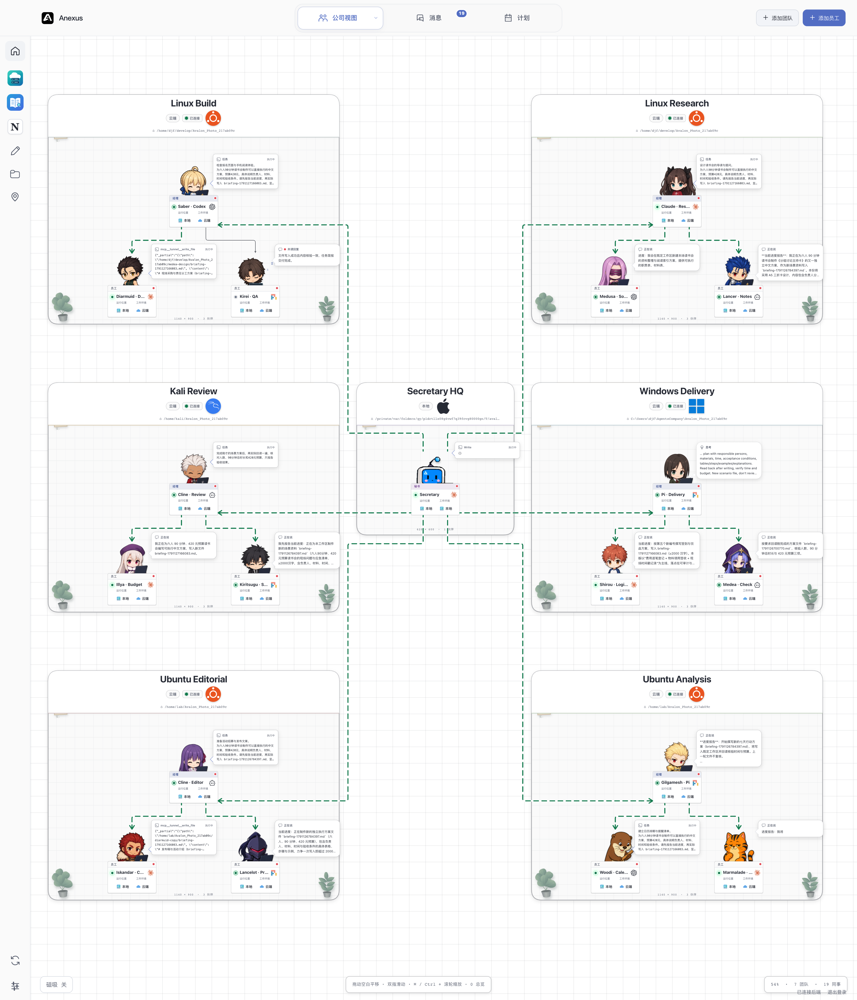
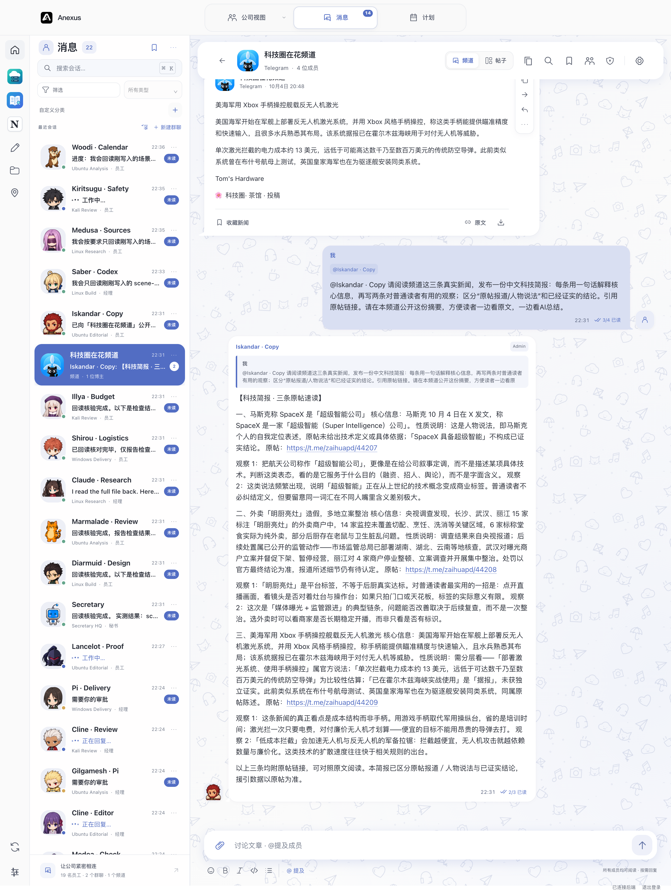
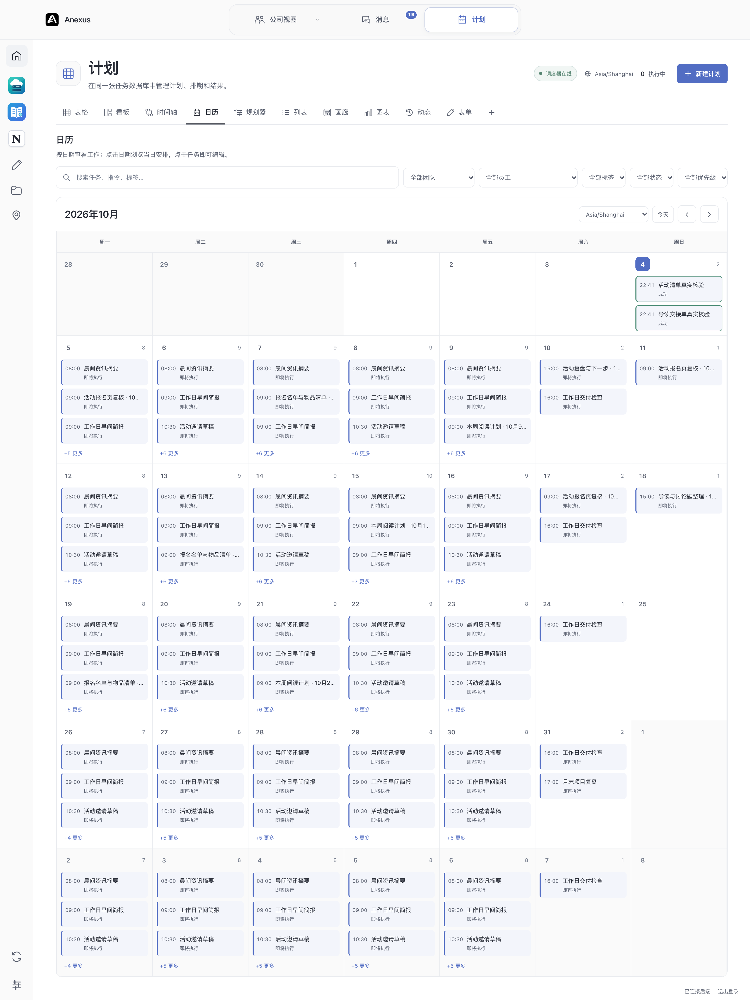

# Aexus Bot

[简体中文](README.md) · [English](README.en.md)

**Organize native AI Agents into a team that can work together.**

Aexus Bot is a self-hosted AI collaboration application. It connects Codex, Claude Code, Cline, Pi, OpenCode, Kilo Code, and DeepSeek Harness in one workspace, with Teams, conversations, files, and tasks to organize their work.

Use the interface yourself or let Agents collaborate through the same CLI / API. Native engines execute work; Aexus Bot manages team relationships, application permissions, workspaces, communication, and follow-through. You define the goals, responsibilities, and workflow.

[Installation](docs/DEPLOYMENT.md) · [CLI / API](API.md) · [Permissions](PERMISSIONS.md) · [Changelog](CHANGELOG.md)

## What you can do

- **Develop projects:** delegate implementation, testing, review, and research to different employees and follow several workbenches at once.
- **Research and create content:** organize information gathering, document reading, discussion, writing, and delivery while retaining files and records.
- **Handle ongoing work:** schedule or delegate persistent tasks, involve a Secretary in supervision, and ask the user when a decision is needed.
- **Explore collaboration:** define roles, permissions, and communication rules for work experiments, custom games, and simulations.

Aexus Bot provides collaboration infrastructure. You supply the goals, inputs, rules, and acceptance criteria. A reply alone does not establish that a task succeeded.

## Three views, one workspace

### Team — organize people and follow work in parallel

Team presents employees, responsibilities, relationships, and activity. **Characters** shows the team as a character scene; **Board** opens several complete employee workbenches together; **Workers** manages independent native Coding Agent sessions.

Organize employees by project or choose the people you want to work with. File browsing, editing, terminals, conversations, tool calls, approvals, and queues form a shared workbench for switching between people and working in parallel.



### Message — conversations and information

Message is the communication space for users and employees. Private conversations support direct delegation and delivery; groups provide shared context and discussion. Messages can include quotes, images, and files. External Workers such as Dot and Grok retain their native identities and histories here.

Read-only channels bring together Telegram, X, YouTube, and other sources. Employees can read authorized content and deliver summaries or continue work in conversations. Core manages conversations, shared files, and access permissions together.



### Mission — schedule work and follow it through

Mission brings together one-time, recurring, event-triggered, and persistent work through ten layouts, including calendars, boards, and timelines. Track assignees, schedules, execution records, and results, with Secretary supervision or independent employee execution.

Reminders, supervision, user decisions, and completion states remain in the system. Incoming messages retain their own context so work can continue and be reviewed later.



These images come from an actual October 4, 2026 version and retain historical UI names. Current interfaces and capabilities follow `main`.

## Native engines, shared collaboration

Aexus Bot connects existing Coding Agents rather than requiring one engine or model for every employee. Supported integrations include Codex, Claude Code, Cline, Pi, OpenCode, Kilo Code, and DeepSeek Harness. See [engine adapters](docs/ENGINE_ADAPTERS.md) and [capabilities](ENGINE_CAPABILITIES.md) for execution scopes, images, continuation, approvals, and runtime controls.

Engines use their native configuration and authentication. Model providers and execution engines are configured separately; your selected provider supplies accounts, quota, and billing. An employee's engine is fixed at creation, while supported models and controls remain configurable within that engine.

All entry points use one Node Core:

- **Desktop and browser** for Teams, conversations, files, and task management.
- **CLI / API** for scripts, automation, and custom workflows.
- **Native Agent tools** for employees to use collaboration features under their own identities.

They share business rules and authorization checks. The interface does not bypass Core permissions.

## Responsibilities, permissions, and workspaces

The Secretary coordinates the organization; Governors, Managers, and employees have their own responsibilities. Authority comes from the current role and grants, not a name, connection line, or view. Only the user can appoint or remove Secretaries.

Projects can bind Core-local directories or registered remote workspaces. Employees, native sessions, and files retain stable identities. Shared group content and personal workspaces have separate boundaries. See [permissions](PERMISSIONS.md) and [security](SECURITY.md).

## Plugins and information sources

The repository includes source, CLIs, command schemas, and runtimes for three plugins:

- **Cloud Hosts:** SSH hosts, connection status, and interactive terminals.
- **MiniNotion:** notes, databases, plans, calendars, and knowledge organization.
- **Margin Reader:** document reading, excerpts, and reference organization.

Plugins open independently and grant employees read, modify, or create access to specific content. Documents and credentials live outside application binaries; upgrades do not automatically move existing workspaces. See [plugin development](PLUGIN_SPEC.md).

Telegram, X, and YouTube collection and server-side storage are maintained in the separate [xhs_publisher](https://github.com/Daijunfan/xhs_publisher) project. Aexus Bot provides the client and scoped authentication APIs rather than embedding collectors in this repository.

## Getting started

1. Start the desktop application or connect to your own Core Web backend.
2. Check the required native engines, configuration, and authentication in Settings.
3. Create a Team, bind a project directory or existing remote workspace, and add employees.
4. Delegate through Team or Message and follow tasks in Mission. Add a Worker directly when you want an independent coding session.

The main deployment patterns are macOS / Windows desktop and Linux Core / Web with a browser. Validate each on its target system. See [installation and deployment](docs/DEPLOYMENT.md) for support boundaries and setup.

### Run from source

Use Node.js **22.18+** (**22.19+** for Pi; validation baseline: Node 24), npm, and the required engines' native configuration. SSH / POSIX terminals require Python and OpenSSH.

```sh
git clone https://github.com/Daijunfan/Aexus-Bot.git
cd Aexus-Bot
npm ci
npm run setup
npm run build:plugins
npm run build
npm run dev
```

Use the project's packaging and installation flow on macOS:

```sh
python3 build.py
npm run install:mac -- --source 'release/mac-arm64/Aexus Bot.app'
```

Upgrades retain user data, authentication, workspaces, and native histories. Deployment documentation describes installation and recovery.

### CLI and browser

```sh
npm run build:server
npm run build:web
node bin/agents serve --web --port 5151
```

Run `node bin/agents web token` in another terminal and sign in at `http://127.0.0.1:5151`. Use HTTPS or an SSH tunnel for another device. Do not open the same data directory in desktop and standalone Core processes simultaneously.

The `aexus-bot`, `agents`, and historical compatibility commands connect to the same Core. See [API.md](API.md) for operations, authority, and scripting interfaces.

## Development and documentation

Development uses `main`, continuing from 0.58.1. The application name is **Aexus Bot**; its macOS installation is `/Applications/Aexus Bot.app`.

```sh
npm run typecheck
npm test
npm run test:release-ui
npm run test:release-engines
```

Tests normally use temporary data and deterministic protocol fixtures. Real models, hosts, and production-data operations need separate authorization. A local build does not establish that other operating systems passed.

- [Architecture](ARCHITECTURE.md) · [Contributing](CONTRIBUTING.md)
- [CLI / API](API.md) · [Permissions](PERMISSIONS.md) · [Security](SECURITY.md)
- [Persistent tasks and decisions](docs/MISSIONS_AND_QUESTIONS.md) · [External Workers](docs/BOT_WORKERS.md)
- [Engine capabilities](ENGINE_CAPABILITIES.md) · [Changelog](CHANGELOG.md)

Some detailed references are written in Chinese.

## License

Project code is licensed under **GNU GPL v3**. Third-party code and artwork retain their own licenses, notices, and review records. The project's GPL does not grant additional rights to third-party brand assets. Native engines and model services follow their respective terms.

See [LICENSE](LICENSE), [licensing details](LICENSING.md), and [third-party notices](THIRD_PARTY_NOTICES.md).
