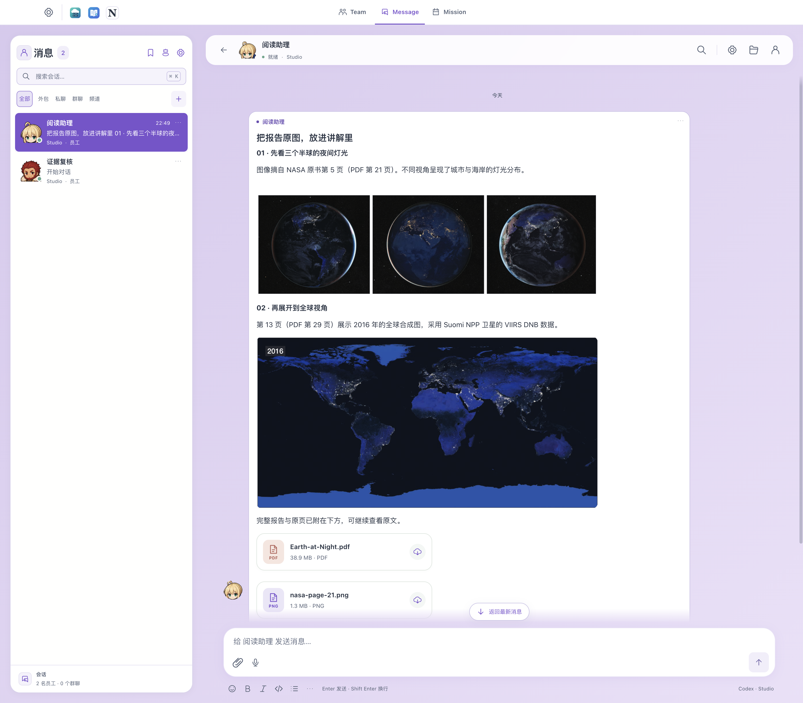
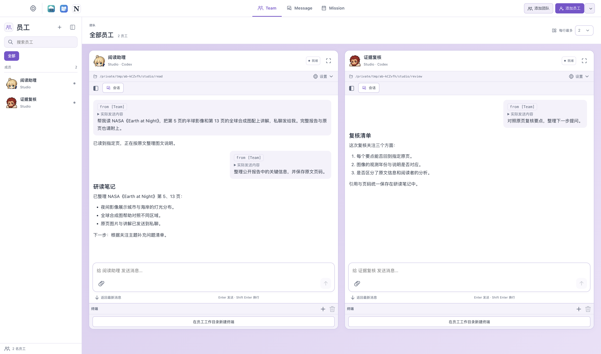
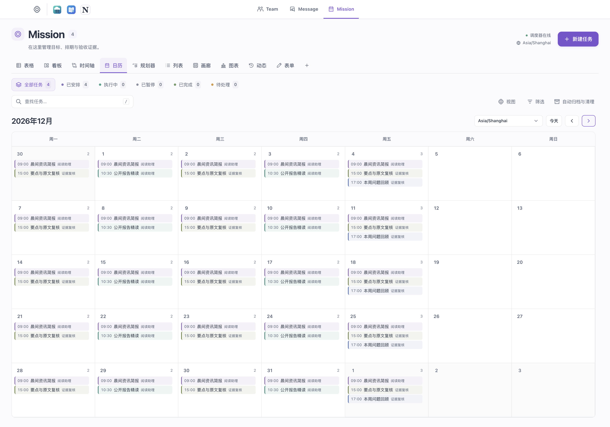

# Aexus Bot · 私人 AI 情报团队

[简体中文](README.md) · [English](README.en.md)

**打造信息平权。**

订阅世界的信息，让 AI 团队替你阅读、讨论、核对，持续交付你关心的结果。

Aexus Bot 把资讯频道、文档、多个 Agent 与持续任务放进同一个工作台。用 **Message** 汇集信息、交办工作，用 **Team** 组织成员、跟进过程，用 **Mission** 安排长期关注与交付。

[开始使用](#开始使用) · [部署指南](docs/DEPLOYMENT.md) · [CLI / API](API.md)

## 让团队帮你读外刊

选中一期外刊、一份报告或一篇长文，交给成员下载到自己的工作区。指定问题、文章范围与页码，让团队带着你的关注点阅读。



<p align="center"><sub>报告图像摘录与讲解交替呈现在同一条消息中，保留完整原文。</sub></p>

> 阅读这期外刊中与 AI 行业有关的文章。每个主题先解释要点，再放上对应的原页图片，最后列出值得继续追问的问题，合成一条图文消息发给我。

成员可以导出 PDF 指定页的原图，在**同一条消息**中按“文字—图片—文字—图片”连续讲解，也可以按主题拆成多条消息。图片支持预览、放大与下载，图文内容按你的阅读节奏组织。

这套流程贯穿私聊、群组和讨论串，本地与云端工作区使用同一套接口。[查看外刊阅读流程](docs/MAGAZINE_READING.md)。

## 从关注的信息，到值得采取的行动

| 你想完成的事 | 团队的工作方式 |
| --- | --- |
| 跟踪行业、技术与专题 | 订阅来源，按主题分工阅读，整理简报并附上原文线索。 |
| 理解论文、报告与长文 | 阅读资料，提取重点，结合原页图表解释观点与依据。 |
| 比较同一问题的不同判断 | 让成员分别分析、独立复核，再围绕同一组材料讨论。 |
| 每天收到有用的简报 | 设置时间、负责成员与交付形式，持续积累阅读与执行记录。 |
| 把发现转成后续工作 | 保存用户决定，分派任务，通过提醒与监督跟进结果。 |

你的来源、资料、工作区与成员职责由你安排。过去需要多人分工的信息工作，也可以成为个人日常使用的能力。

## 三个视图，连接阅读、协作与交付

### Message · 信息与讨论的中心

把资讯频道、私聊和群组放在一起，读到值得关注的内容，就能接着提问、讨论与交办。
消息在浮动标题栏与输入栏的圆角两侧自然延伸，保留柔和的毛玻璃渐变，让长文阅读与对话衔接起来。

- **资讯频道**：汇集 Telegram、X、YouTube、知乎与 LinkedIn 的内容，按来源、关键词和时间筛选；成员也能通过接口阅读与搜索。
- **丰富消息**：使用图文、引用、讨论串、表情标记、投票与协作清单，在同一段上下文中交流、补充和汇总。
- **共享资料**：预览图片与文档，在 Margin Reader 中阅读 PDF，编辑与管理文件，并从相关消息继续追问。

Dot、Grok 等外部 Worker 保留各自的原生身份与历史。你可以在 Message 中管理 Bot、原生群组、成员与运行配置，界面和 CLI 使用同一套管理接口。在 macOS 上完成官方应用的安装与登录后，Aexus Bot 可接入本机执行通道，让桌面和 Web 会话都能调用你的 Mac。[原生 Bot 接入](docs/BOT_WORKERS.md) · [Message 工作台](docs/MESSAGE_EXPERIENCE.md)。

### Team · 组织你的情报成员

为成员安排关注方向和职责：资讯追踪、资料阅读、专题分析、独立复核、简报整理。秘书协调工作，你可以随时打开成员工作台，查看实际进展。

角色员工与原生 **Worker** 共用一张并行工作看板，统一搜索、分类与跟进。会话、文件、终端、工具调用、授权和队列都在成员工作台中；Worker 使用独立原生会话，保留干净的原生上下文。

可接入 **Codex、Claude Agent、Cline、Pi、OpenCode、Kilo Code、DeepSeek Harness、Google Antigravity**。选择你的模型与原生配置，在本机或已登记的远程工作环境中安排执行。[查看引擎能力](ENGINE_CAPABILITIES.md)。



### Mission · 让重要的事持续推进

把一次性、重复、事件触发与持续目标放进日历、看板、列表或时间线，按自己的关注方式保存过滤与视图。



任务可以由秘书监督，也可以交给成员独立完成。提醒、执行记录和交付结果连在一起，持续目标通过明确的成功确认结束。

需要你决定的问题会保存在会话中：自由设置选项，使用 **Other** 补充自己的回答，选择超时自行决定或持续等待。你可以先处理其他消息，再回来作出决定。[持续目标与用户决策](docs/MISSIONS_AND_QUESTIONS.md)。

## 让资料、工具与工作空间协同

工作区可以使用本机或已登记云主机中的目录。成员使用自己的工作区，群组集中管理共享资料，文件与原生会话在升级时保留稳定身份。

| 插件 | 用途 |
| --- | --- |
| **Margin Reader** | 阅读 PDF 与文档，摘录内容，整理参考资料。 |
| **MiniNotion** | 组织笔记、数据库与知识。 |
| **Cloud Hosts** | 管理远程主机、连接与终端。 |

按具体内容为成员分配阅读、修改或新增权限。桌面、浏览器、CLI / API 与成员工具共用一个 Core，让同一项工作可以从不同入口继续完成。

资讯采集与服务端存储由独立项目 [xhs_publisher](https://github.com/Daijunfan/xhs_publisher) 维护；订阅管理和内容阅读统一回到 Aexus Bot。[资讯频道](docs/CHANNELS.md) · [工作区与文件](docs/FILES_WORKBENCH.md) · [权限管理](PERMISSIONS.md)。

## 开始使用

1. 启动桌面应用，或连接自己的 Core Web 后端。
2. 在设置中选择引擎，完成模型配置与认证。
3. 创建团队，绑定工作区，为成员安排职责。
4. 接入资讯来源、提供文档，或直接提出一个问题。
5. 在 Message 中讨论，在 Team 中跟进，通过 Mission 安排持续交付。

[查看部署指南](docs/DEPLOYMENT.md)，选择 macOS / Windows 桌面，或 Linux Core / Web 与浏览器的组合。

<details>
<summary>从源码运行、打包与部署</summary>

需要 Node.js **22.18+**（Pi 使用 **22.19+**）与 npm。SSH 工作流还需要 Python 和 OpenSSH。

```sh
git clone https://github.com/Daijunfan/Aexus-Bot.git
cd Aexus-Bot
npm ci
npm run setup
npm run build:plugins
npm run build
npm run dev
```

macOS 打包与安装：

```sh
python3 build.py
npm run install:mac -- --source 'release/mac-arm64/Aexus Bot.app'
```

浏览器后端：

```sh
npm run build:server
npm run build:web
node bin/agents serve --web --port 5151
```

另开终端运行 `node bin/agents web token`，在 `http://127.0.0.1:5151` 登录。远程连接和服务配置见[部署指南](docs/DEPLOYMENT.md)。

</details>

## 深入了解

- [部署指南](docs/DEPLOYMENT.md) · [CLI / API](API.md) · [架构](ARCHITECTURE.md)
- [外刊阅读](docs/MAGAZINE_READING.md) · [群组协作](docs/GROUP_COLLABORATION.md) · [资讯频道](docs/CHANNELS.md)
- [引擎能力](ENGINE_CAPABILITIES.md) · [插件开发](PLUGIN_SPEC.md) · [贡献指南](CONTRIBUTING.md)
- [权限管理](PERMISSIONS.md) · [安全说明](SECURITY.md) · [变更记录](CHANGELOG.md)

## 许可

项目代码采用 **GNU GPL v3**。[LICENSE](LICENSE) · [许可说明](LICENSING.md) · [第三方声明](THIRD_PARTY_NOTICES.md)。
