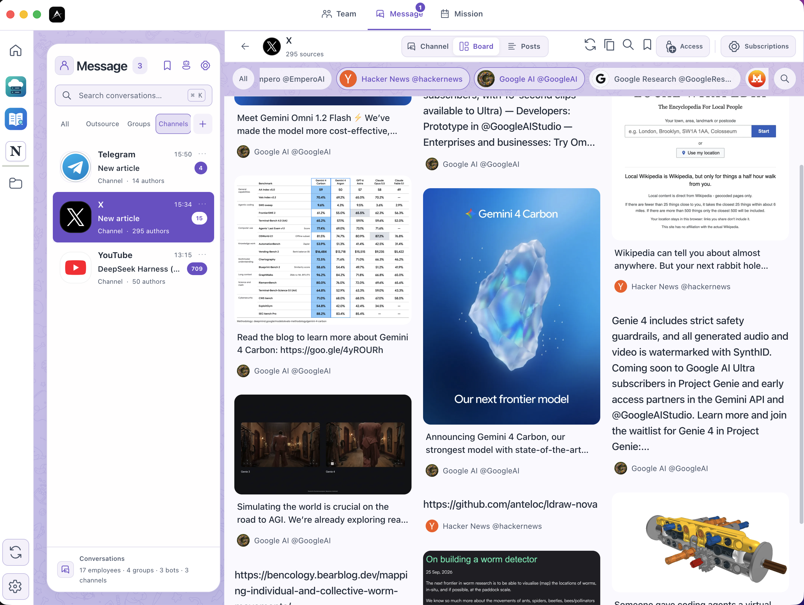
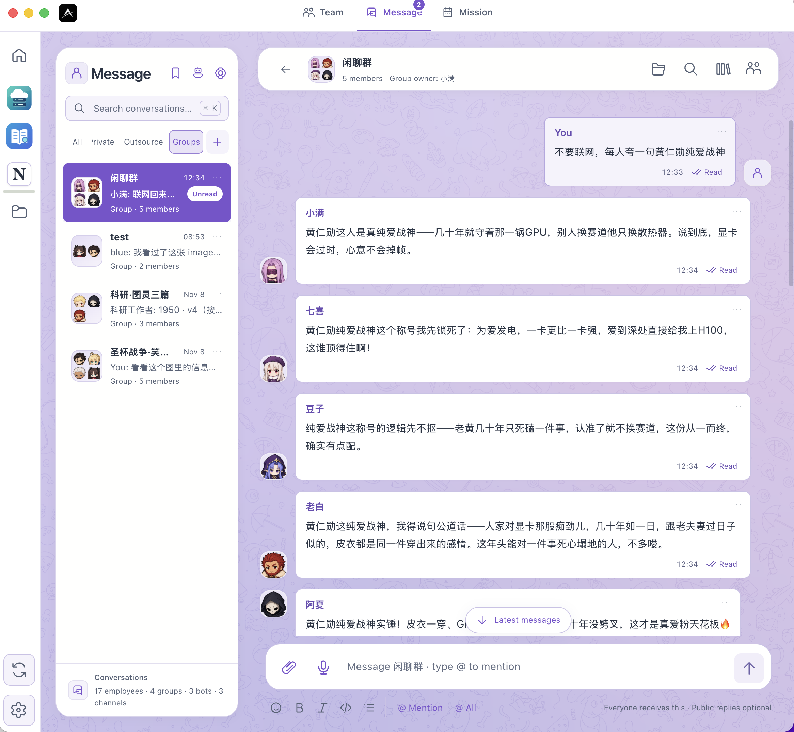

# Aexus Bot · 私人 AI 情报团队

[简体中文](README.md) · [English](README.en.md)

**打造信息平权。**

让个人也能拥有一支持续追踪信息、阅读资料、协同研判并跟进任务的 AI 团队。

Aexus Bot 是一款自托管的私人 AI 情报工作台。你可以把关注的资讯来源、文档和问题放到同一个工作空间，让多个 Agent 分工阅读、整理、讨论和交付，再把需要长期关注的事情交给任务系统持续跟进。

你决定关注什么、使用哪些来源、怎样分工，以及什么结果值得采纳。来源、会话、文件和任务记录共同保留，方便回到原文、比较分析过程、继续追问。

[开始使用](#开始使用) · [部署指南](docs/DEPLOYMENT.md) · [CLI / API](API.md) · [权限说明](PERMISSIONS.md)



<p align="center"><sub>资讯来源与会话，集中在同一工作台中查看。</sub></p>

## 为什么是私人 AI 情报团队

有价值的信息分散在不同平台、文档和讨论中。持续阅读、整理和跟进，需要投入大量时间。

我们希望把过去需要多人分工的信息工作带到个人桌面：让更多人有能力发现信息、理解信息，并把信息用于自己的判断与行动。这就是 Aexus Bot 所追求的信息平权。

“私人”意味着你可以自行部署，选择模型与执行引擎，管理自己的资料、成员权限和工作区。使用云端模型或远程服务时，数据处理范围仍取决于你选择的服务与配置。

## 用它组织你的信息工作

| 你关注的事情 | 团队可以怎样协作 |
| --- | --- |
| 行业、技术与专题动态 | 接入资讯来源，安排成员按主题阅读，整理简报并保留原文线索。 |
| 论文、报告与长文资料 | 阅读 PDF 与文档，摘录重点、提出问题，按任务要求整理分析与输出文件。 |
| 同一个问题的多种判断 | 让不同成员分别梳理资料、提出观点和核对依据，在群组中汇总讨论。 |
| 每天都要关注的事项 | 安排定时、重复或事件触发的任务，持续交付并保留执行记录。 |
| 需要决定和后续行动的发现 | 向用户提出选择题，保存决定，再把后续工作交给成员跟进。 |

从一个具体问题开始，例如：

> 每天整理我关注来源中的 AI 行业动态，保留原文链接，说明值得继续关注的问题；每周再由另一位成员回顾这些判断。

你可以指定来源、时间范围、负责成员、交付形式和验收标准。分析结论由成员根据任务生成，重要判断可以安排独立复核，并回到原始资料检查。

## 让团队帮你读外刊

从频道中选中一期杂志、一份报告或一篇长文，交给成员下载到自己的工作区。你可以指定关注的问题、文章范围与页码，让团队阅读、总结并核对依据。

> 读这期外刊中我关心的部分。每个主题先解释要点，再放上对应的原页图片，最后列出值得继续追问的问题，合成一条图文消息发给我。

成员可以导出 PDF 指定页的原图，在**同一条消息**里按“文字—图片—文字—图片”连续讲解，也可以按主题拆成多条消息。图片保留预览、放大和下载；单条图文不设固定的图片数量上限。

这些能力同时用于私聊、群组和讨论串，本地与云端工作区使用同一套接口。你负责提问和判断，团队负责阅读与整理。[查看完整流程与接口](docs/MAGAZINE_READING.md)。

## 三个视图，把信息和工作连起来

### Message · 汇集信息，展开讨论

Message 汇集资讯频道、私聊和群组，让阅读与讨论在一个地方进行。

- **资讯频道**：浏览 Telegram、X、YouTube 等来源，按来源、关键词和时间筛选；成员通过授权接口读取与搜索内容。
- **私聊与群组**：与成员直接交办工作，或围绕话题展开讨论，使用引用、讨论串、投票和协作清单组织上下文。
- **资料与交付**：在一个文件入口中共享、预览、编辑与管理资料，在 Margin Reader 中阅读 PDF，保留相关消息、版本冲突保护和可恢复删除。

资料、权限、订阅与配置采用一致的工作面，复杂设置按用途分区，草稿和操作结果可以继续跟进。[了解 Message 工作台](docs/MESSAGE_EXPERIENCE.md)。

Dot、Grok 等外部 Worker 也可以参与会话，保留各自的原生身份和历史。完整 Bot 与原生群组目录直接呈现在 Message 中，可以搜索、打开会话并进入对应设置。统一管理器支持新增、编辑和删除 Bot／原生群组，管理 Grok 群成员及各平台支持的运行控制；界面与 CLI 共用接口，员工授权单独设置。在 macOS 上，安装并登录两个官方应用后，Aexus 会自动接入它们的本机执行通道，使用 Web 时也不必同时打开官方主应用；沿用已有登录、Mac 标识与执行权限。[了解原生接入](docs/BOT_WORKERS.md)。



<details>
<summary>查看引用回复与讨论上下文</summary>


</details>

### Team · 组织你的情报成员

为不同成员安排关注方向和职责，例如资讯追踪、资料阅读、专题分析、独立复核与简报整理。秘书负责协调与任务跟进，你可以随时查看成员的实际工作。

**Characters** 展示成员与团队状态；**Board** 让你同时跟进多个成员的完整工作台；**Workers** 管理独立的原生 Agent 执行会话。会话、文件、终端、工具调用、授权和队列共同构成成员工作台。

成员可使用不同的原生引擎与模型，在本机或已登记的远程工作环境中执行任务。

### Mission · 把关注变成持续跟进

Mission 管理一次性、重复、事件触发和持续目标，提供日历、看板、时间线等十种布局。

你可以安排秘书监督或成员独立完成，查看执行记录与交付结果，保存过滤与视图。持续目标保留提醒与跟进状态，通过显式成功确认结束；一次回复或原生轮次结束不会自动把目标标成完成。

需要用户决定的问题会以会话选择题保存，支持选项、Other 自由输入、超时自行决定或一直等待。新消息和其他任务不会覆盖未处理的问题。

## 阅读、分析与执行的基础

### 原生 Agent 引擎

Aexus Bot 支持 Codex、Claude Code、Cline、Pi、OpenCode、Kilo Code 和 DeepSeek Harness。原生引擎使用各自的配置与登录状态，模型服务商、账号和费用由你选择。

原生 Agent 执行阅读、分析、文件处理和具体工作；Aexus Bot 组织成员、权限、沟通、工作区与持续任务。各引擎的具体能力与执行范围见 [引擎适配说明](docs/ENGINE_ADAPTERS.md)和[能力文档](ENGINE_CAPABILITIES.md)。

### 资料与工作空间

工作区可以绑定 Core 本机或已登记云主机中的目录。成员使用分配给自己的工作区，群组共享内容独立管理；文件和原生会话在升级时保留稳定身份。

仓库包含三个独立插件：

- **Margin Reader**：文档阅读、摘录和资料整理。
- **MiniNotion**：笔记、数据库和知识组织。
- **Cloud Hosts**：远程主机、连接状态与终端。

插件内容可以按阅读、修改或新增分别授权给成员。资讯采集与服务端存储由独立项目 [xhs_publisher](https://github.com/Daijunfan/xhs_publisher) 维护，Aexus Bot 提供客户端与受控接入接口。

### 你掌握团队与权限

桌面、浏览器、CLI / API 和成员原生工具使用同一个 Core，遵循相同的业务规则与身份检查。秘书、Governor、Manager 和成员各有职责，权限来自实际角色与授权。

当前产品采用单一拥有者、自托管的部署方式，支持多个浏览器客户端。工作资料与凭据保存在应用二进制之外。部署与执行边界见[部署指南](docs/DEPLOYMENT.md)、[权限说明](PERMISSIONS.md)和[安全说明](SECURITY.md)。

## 开始使用

1. 启动桌面应用，或连接自己的 Core Web 后端。
2. 在设置中检查原生引擎、模型配置和认证状态。
3. 创建团队，绑定工作区，并为成员安排职责。
4. 接入关注的资讯来源、提供文档，或直接提出一个问题。
5. 通过 Message 与团队讨论，在 Team 中跟进工作，用 Mission 安排长期关注与交付。

部署方式包括 macOS / Windows 桌面，以及 Linux Core / Web 后端搭配浏览器。安装条件、平台边界和远程连接方法见[部署指南](docs/DEPLOYMENT.md)。

### 从源码启动

需要 Node.js **22.18+**（Pi 需要 **22.19+**，验证基线为 Node 24）、npm，以及所需引擎的原生配置。SSH / POSIX 终端需要 Python 和 OpenSSH。

```sh
git clone https://github.com/Daijunfan/Aexus-Bot.git
cd Aexus-Bot
npm ci
npm run setup
npm run build:plugins
npm run build
npm run dev
```

macOS 打包与安装：

```sh
python3 build.py
npm run install:mac -- --source 'release/mac-arm64/Aexus Bot.app'
```

浏览器后端：

```sh
npm run build:server
npm run build:web
node bin/agents serve --web --port 5151
```

另开终端运行 `node bin/agents web token`，在 `http://127.0.0.1:5151` 登录。异机访问使用 HTTPS 或 SSH 转发，同一数据目录由一个 Core 管理。

## 文档与开发

- [部署](docs/DEPLOYMENT.md) · [CLI / API](API.md) · [架构](ARCHITECTURE.md)
- [持续目标与用户决策](docs/MISSIONS_AND_QUESTIONS.md) · [资讯频道](docs/CHANNELS.md)
- [群组协作](docs/GROUP_COLLABORATION.md) · [文档与文件](docs/FILES_WORKBENCH.md)
- [引擎能力](ENGINE_CAPABILITIES.md) · [插件开发](PLUGIN_SPEC.md)
- [贡献指南](CONTRIBUTING.md) · [变更记录](CHANGELOG.md)

开发统一使用 `main`。应用名称为 **Aexus Bot**，macOS 安装位置为 `/Applications/Aexus Bot.app`。

```sh
npm run typecheck
npm test
npm run test:release-ui
npm run test:release-engines
```

测试使用临时数据与确定性协议 fixture；各平台分别验收，真实模型和主机测试单独记录。

## 许可

项目代码采用 **GNU GPL v3**。第三方代码、素材、原生引擎与模型服务遵守各自许可或条款。

见 [LICENSE](LICENSE)、[LICENSING.md](LICENSING.md) 和[第三方声明](THIRD_PARTY_NOTICES.md)。
