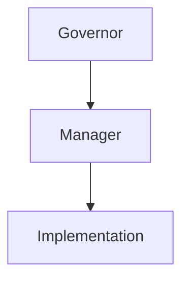
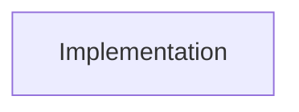

# Engineering

Engineering is a Team workspace for engineering orchestration, native Worker execution and explicit multi-level acceptance. Each project binds one independent Team and exactly one Mission. Topology and DAG display the same saved roles, tasks, native runs and reviews together. Research is an entry only. Characters retains its numbered seats and existing Team geometry; Engineering graph positions are separate.

## Create and manage

The user or Secretary creates projects in **Team → Engineering → New engineering** or through the same authenticated CLI. Select a new local/cloud Team or bind an existing project Team. The storage picker supports registered hosts, custom folder names and existing folders, separately from the Team label. An existing Team cannot belong to two Engineering projects. Existing employee bindings must have the exact chosen Team and rank; engines, native references and workspaces never change silently.

Example `engineering.json`:

```json
{
  "name": "Release the application",
  "goal": "Deliver the requested change with actual implementation and verification evidence.",
  "team": "Release team",
  "roles": [
    {"key":"governor","title":"Release Governor","rank":"governor","engine":"codex"},
    {"key":"manager","title":"Delivery Manager","rank":"manager","parent":"governor","engine":"codex"},
    {"key":"implementation","title":"Implementation","rank":"employee","parent":"manager","engine":"codex"},
    {"key":"verification","title":"Verification","rank":"employee","parent":"manager","engine":"codex"}
  ],
  "tasks": [
    {"key":"implementation","title":"Implement","prompt":"Implement the requested change.","acceptance":"Actual files and relevant tests demonstrate the requested behavior."},
    {"key":"verification","title":"Verify","prompt":"Independently verify the implementation.","acceptance":"The actual result passes the stated acceptance scenarios."}
  ],
  "dependencies": [{"from":"implementation","to":"verification","requirement":"Verified implementation and reproducible checks."}],
  "managerCheckSeconds": 900,
  "governorCheckSeconds": 1800
}
```

```sh
agents engineering create --spec @engineering.json --client-request-id release-project --json
agents engineering list --json
agents engineering get --id ENGINEERING_ID --json
agents engineering context --id ENGINEERING_ID --json
agents engineering start --id ENGINEERING_ID --expected-revision REVISION --json
```

`key` identifies a graph role/task. `employeeId` optionally binds an existing Company employee. It is distinct from a Worker ID, native session ID, Engineering ID and Mission ID. Context returns the exact mappings, real caller identity, current node/chain, prompt paths and permitted next actions. Creation keys resume saved partial setup without duplicating Team, employees or Mission. Failed setup remains visible and can be retried. Project selection is remembered per client. `engineering.activity` supplies live role state/bubbles without retransmitting historical delivery data. Node execution/review writes tolerate unrelated node updates; changes to that node still require a fresh revision. Archive/restore changes visibility while preserving execution/history.

## Graphs and ownership

Topology is a free pan/zoom canvas with top-down Governor → Manager → Employee management and collaboration edges. DAG flows left to right; each node is an Employee. Native Workers are leaf execution instances in the Employee inspector, never graph nodes. Nodes are circular employee portraits, with names, live status and Worker counts outside the portrait; there are no rectangular node cards. Drag nodes freely; scroll to pan; Command/Ctrl + scroll zooms. Fit, zoom and automatic layout controls are explicit. Focused nodes also move with arrow keys (Shift uses a smaller step). Inspect nodes or connections for ownership, requirements, progress, actual Worker history and both reviews.

Exactly one Governor oversees the project. Each Manager owns one continuous unbranched chain; every Employee has one Manager. A fork source, each separate branch and join continuation need distinct Managers. Ambiguous ownership, cycles, dangling dependencies, duplicate keys and mismatched roles fail before provisioning. These relationships describe work; they do not grant Company authority or another Employee’s Worker controls.

The graphical editor manages roles, bindings, task prompts/acceptance, dependencies, collaboration and check intervals. Engineering creates its Governor task scope using `team-view.create --select false`, so background setup does not switch the user’s current Characters filter. Structural changes require draft/paused state (blocked or interrupted setup can also be repaired) and no active linked Worker runs. Removing a graph role does not delete its Company employee, files or native history. Changed work and dependent acceptance are invalidated; unrelated completed work remains. Check periods may change while running; a goal change requires pause and renewed acceptance.

## Mermaid import/export

The documented deterministic Mermaid flowchart subset supports:

- `flowchart TD` / `graph TD` for Topology and `flowchart LR` for DAG.
- Explicit nodes `key["Title"]:::governor|manager|employee`. Export uses safe `n_`-prefixed Mermaid IDs and stores the original graph key in `@node` metadata, so reserved words such as `end` remain usable project keys. Labels use Mermaid entity escapes for quotes, backslashes and line breaks ([official syntax](https://mermaid.js.org/syntax/flowchart.html)).
- `A --> B` or `A -->|handoff| B` for management/dependencies; chained arrows are accepted.
- `A -.-> B` for Topology collaboration. DAG uses only solid dependencies.
- One statement per line. Unsupported directives, implicit undeclared nodes and executable content are rejected with an explanation.
- `%% @node KEY JSON` preserves identity, native engine/model, position, role check seconds or task prompt/acceptance. `%% @edge FROM TO {"requirement":"..."}` preserves exact multiline requirements without label escaping losses.



Topology import preserves an existing bound identity if metadata omits it, creates explicitly ranked new roles and adds a corresponding task for each new Employee. Removing an Employee removes its task reference and incident dependencies. Edit the task’s detailed prompt afterward. DAG metadata carries an Employee `role` with `parent` (Manager key), `employeeId`, `engine` and `model`. New DAG Employees must specify their Manager:



```sh
agents engineering export --id ENGINEERING_ID --graph topology --json
agents engineering export --id ENGINEERING_ID --graph dag --json
agents engineering parse --graph dag --source 'flowchart LR
implementation["Implementation"]:::employee' --json
agents engineering import --id ENGINEERING_ID --graph dag --source 'MERMAID_TEXT' --expected-revision REVISION --json
```

For a source file, place its exact text in the `source` field of a JSON request and use `agents api call engineering.import --args @request.json --json`. The GUI and CLI share the same parser and merge rules. Export/import preserves real graph data and identities.

## Workers and two-stage acceptance

An Employee becomes ready only after every dependency passed both reviews. It can dispatch multiple directly owned native Workers, including concurrent Workers on one node. Existing Workers must have the exact Employee owner; new Workers use that Employee’s actual host and workspace. The existing native graphical protocols, slash commands, configuration, tools, approvals, files and terminal remain available. No TUI or simulated keystrokes are used.

```sh
agents engineering dispatch --id ENGINEERING_ID --key implementation \
  --text 'Implement and test the change; report real artifacts.' --engine codex \
  --client-request-id implementation-attempt-1 --expected-revision REVISION --json
```

Dispatch durably records the exact task, Worker, engine, receipt, attempt, native session and result. Employee first acceptance may publish exact delivery files with `files:[{runId,path}]`, relative to a completed Worker folder. Project reviewers read only those explicit files through `engineering.artifact --id ID --artifact-id ID --operation read|info|image|chunk`; this does not grant general access to the Employee workspace. File versions are rechecked before Manager approval and Governor final acceptance. Changed or removed files require a new Employee review. The inspector previews published text/images and preserves their version references with the review. Reusing its request key recovers the same run even after unrelated revisions. Failed/interrupted work is not automatically replayed: inspect history, then explicitly use a new key. `engineering.worker-stop` cancels only the linked receipt, preserving unrelated tasks. Worker removal retains the existing process-tree cleanup and does not erase engineering delivery evidence.

1. Actual Worker completion enters Employee review, still grey. The Employee inspects real artifacts and explicitly records first acceptance with evidence.
2. Core automatically wakes that node’s unique Manager with its delivery event.
3. Manager independently checks the result. Only second acceptance turns the node green and automatically activates dependency-ready successors.
4. Rejection records the reason, supersedes the attempt, invalidates dependent acceptance and returns work for new Worker execution and both reviews again.
5. Once every owned node passed, Manager explicitly confirms its whole chain. Core wakes Governor.
6. Governor verifies every Manager confirmation and the integrated result, then explicitly confirms final evidence. Only this succeeds the linked Mission.

```sh
agents engineering employee-review --id ENGINEERING_ID --key implementation \
  --accepted true --result 'Actual artifact and test evidence…' --expected-revision REVISION --json
agents engineering manager-review --id ENGINEERING_ID --key implementation \
  --accepted false --result 'Concrete defects and required corrections…' --expected-revision REVISION --json
agents engineering manager-complete --id ENGINEERING_ID --key manager \
  --result 'Verified whole-chain outcome…' --expected-revision REVISION --json
agents engineering complete --id ENGINEERING_ID --result 'Verified integrated outcome…' --expected-revision REVISION --json
agents engineering reopen --id ENGINEERING_ID --key manager \
  --result 'Final inspection found this defect…' --expected-revision REVISION --json
```

User/Secretary may explicitly perform these stages on the user’s behalf; each remains a separate event signed by the real authenticated caller. Employees cannot self-approve the Manager stage. Managers cannot impersonate Governor. Ordinary `mission.complete/update/reopen/delete` cannot bypass an Engineering Mission’s gates; its details open Engineering instead. Mission reflects real project state and accepted-node progress.

DAG nodes are grey until both stages pass, then green. Running links flow green with matching arrows; paused links are yellow; failed/rework links red; successful links static green. Reduced-motion keeps the color semantics without animation.

## Periodic checks, pause and recovery

Use `engineering.wake --id ID --key ROLE --message "Progress or blocker evidence" --expected-revision N` to report to a parent or explicit collaboration partner. Reports preserve the real sender and do not grant general employee-control authority; pending reports survive later messages. Periodic wakeup history is bounded, while explicit reports and Worker/review history remain saved.

Every Manager/Governor has a saved next-check time, default interval and optional per-role `checkSeconds`. Core wakes roles on periodic checks and actual delivery/review/chain events. Periodic notices coalesce with existing project work. Completed Managers stop their cycle; Governor final acceptance stops all cycles. Governor can reopen an inadequate chain, cancel its exact superseded Worker receipts and invalidate downstream results, while retaining unrelated accepted branches.

Pause suspends new wakeups and advancement. Already accepted native Worker tasks may finish and retain delivery for later review; **Stop this run** actually interrupts them. Resume retains pending work and both review histories. Archive is only a visibility action. Engineering Missions retain their linked acceptance history; an automatic delete-retention policy archives these linked records instead of deleting their required project reference.

Project participants and user/Secretary can read project context. Configuration belongs to user/Secretary. Current identity, actual rank/Team, creator credential, node ownership and project generation are rechecked before dispatch and queued execution. Deleted/demoted roles or revoked credentials block work rather than borrowing an operator token or changing hosts. Repair configuration under current authority, then resume. Bound employee IDs and engines remain fixed; a replacement uses a new explicit role key. Existing Company ranks are changed through the normal employee role interface/`card.management-role`; then synchronize the graph with the actual rank (or use the editor’s current-rank action). A blocked project can be repaired without changing its Team, employee IDs, native references or Mission. The editor can explicitly replace an unavailable Governor; the same Mission then follows the current Governor.

Restart retains attempts, reviews, runs, prompts, intervals and pause state. Interrupted native work is not replayed. An enqueue interrupted at an uncertain boundary remains visible with an explanation: inspect history, then `engineering.wake --id ID --key ROLE --expected-revision N` explicitly requests a new wakeup. Reconciliation into the existing Mission is idempotent. Storage failures report an error rather than inventing success or replacement identities.

## Prompt folder and one initialization router

All roles receive the same short project initialization router. Detailed behavior lives in the Engineering-bound prompt folder:

```text
index.md          common route and actual identity lookup
overview.md       overall engineering goal
governor.md       final supervision and acceptance
manager.md        chain supervision and second acceptance
employee.md       Worker orchestration and first acceptance
worker.md         native implementation and verification
acceptance.md     project standards
notes.md          conventions and user decisions
roles/KEY.md      role-specific instructions
nodes/KEY.md      node-specific task and acceptance
structure.json    generated current graph/identity manifest (read-only)
```

The user/Secretary edits files through **Prompts**, the authenticated API or directly in the canonical Core folder. Before execution, files are mirrored into `.aexus-engineering/ENGINEERING_ID/prompts/` inside the actual role/Worker workspace using the existing local/remote file boundary. Graph manifest updates preserve user-edited notes. Unedited generated role/node templates follow graph changes; explicitly edited prompt files remain yours. A native Worker receives the same router and its explicit assignment, without Company credentials or application tools. Company roles recover their exact scope with `engineering.context`.

```sh
agents engineering prompts --id ENGINEERING_ID --json
agents engineering prompts --id ENGINEERING_ID --path notes.md --json
agents engineering prompts --id ENGINEERING_ID --path notes.md \
  --content 'Project instructions…' --expected-version CONTENT_HASH --json
```

Prompt saves check exact content versions; graph/actions check project revisions; creation/run keys recover saved attempts. Browser paths are never treated as Core paths. Desktop, Web, CLI and native employee tools call the same authenticated Core operations.
